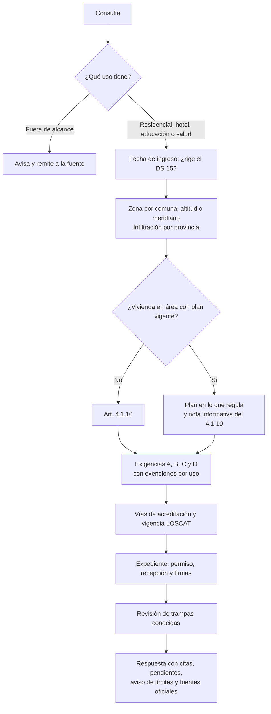
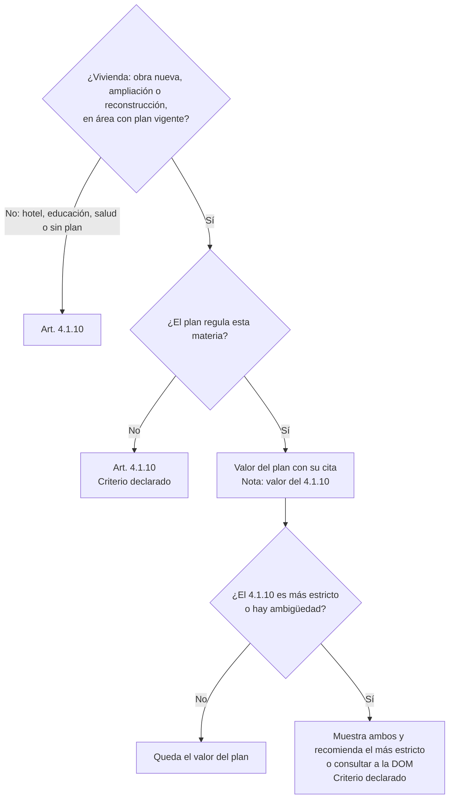
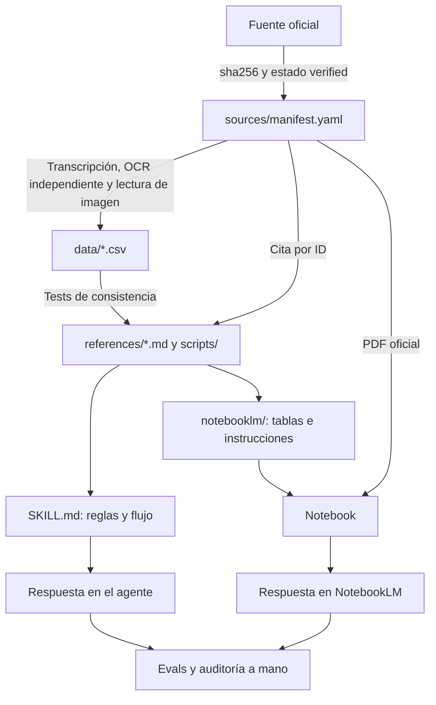

# Cómo funciona la skill y qué manda sobre qué

Este documento explica cómo razona la skill, qué fuente rige en cada materia y qué decisiones son norma expresa o criterio propio. Sirve para entenderla y para auditarla. Es la autoridad sobre la prevalencia: `AGENTS.md`, `SKILL.md` y `references/pda-ppa.md` la resumen.

## 1. Flujo de una consulta

## 2. Qué manda sobre qué

La prevalencia se decide **por materia y por uso**. No es una lista única de documentos.

El Art. 4.1.10 inc. 2° dice que, en permisos de obra nueva, ampliación o reconstrucción de viviendas en áreas donde se aplica un plan, "deberá estarse, en materia de exigencias de acondicionamiento térmico, a lo dispuesto en dicho Plan". **No compara qué exigencia es más estricta.** No hallamos una interpretación oficial de este inciso; búsqueda limitada, con fecha 2026-11-05.

Fuera de esa decisión, las fuentes se ordenan así: resoluciones MINVU, luego manuales y guías (MRT, láminas DITEC) y al final material secundario. Una resolución no compite con el 4.1.10 cuando el artículo le encarga fijar un método, como la Res. Ex. 1802 con las condiciones de cálculo de condensación.

### Fuente por materia

| Materia | Sin plan, o uso no vivienda | Vivienda con plan |
|---|---|---|
| U y Rt | Tablas 1 (residencial y hotel) y 10 (educación y salud) | Tabla del plan, etapa según la fecha |
| R100 | Tablas 2 y 11 | Tabla del plan. Talca difiere: C33 |
| Sobrecimiento | Tablas 6 y 13 | Plan o acto MINVU que lo completa |
| Ventanas | Tablas 3 a 5 (residencial); Tabla 12 (hotel, educación y salud) | Plan más acto MINVU, sin U máximo en varios planes |
| Condensación | DS 15 literal B + Res. Ex. 1802. Hotel exento | Condiciones del plan y sus actos; lo no regulado, Res. Ex. 1802 |
| Infiltración | Tablas 7 y 14; muestra en Tablas 8 y 15. Hotel exento | Clase, muestra y sellos del plan cuando los regula |
| Permeabilidad | Tablas 9 y 16. Hotel exento | Tabla del plan, a veces en otra unidad |
| Ventilación | DS 15 literal D. Hotel y salud eximidos; educación solo NCh 3308 | Lo que regule el plan; si no, literal D |
| Exigencias propias del plan (como calefacción sin leña) | No aplican | Rigen por el plan |

Qué regula exactamente cada plan está en `data/pda.csv`, `data/pda_minvu_actos.csv` y `references/pda-ppa.md`. `scripts/pda.py <comuna>` entrega las filas del plan y la comparación con el 4.1.10.

**Lo comparado en U, R100, sobrecimiento e infiltración:** en la última etapa de los 11 planes con envolvente, el plan nunca resultó más estricto y casi todos los valores son iguales. El 4.1.10 es más estricto en dos casos: Talca (C33) y la parte en zona H de comunas de O'Higgins y Curicó, si el plan llegara a esa altitud (C34). El % de ventanas y la permeabilidad no se comparan por script.

## 3. De la fuente a la respuesta

| Etapa | Control | Qué no garantiza |
|---|---|---|
| Fuente | `sha256` y lectura contra el texto oficial | Que no exista una norma posterior: ver `docs/mantencion.md` |
| Datos | OCR independiente, imágenes y tests como Rt≈1/U | Lectura correcta en cada celda no muestreada |
| Skill | Tests de scripts, citas y referencias | Que el modelo siga cada regla |
| Notebook | `scripts/build_notebook.py --verificar` y preguntas contra `data/` | El notebook no corre scripts y responde con variación |
| Respuesta | Evals por reglas y juez, y auditoría de una muestra | Cada frase: por eso se audita a mano y se cierra con el aviso de límites |

## 4. Registro de hipótesis

Es lo que conviene auditar primero. **Base:** norma expresa, criterio declarado o pendiente.

| ID | Hipótesis | Base | Sustento | Si fuera falsa |
|---|---|---|---|---|
| H01 | En vivienda con plan vigente, en lo que el plan regula, se está al plan | Norma expresa | Art. 4.1.10 inc. 2° | Cambian todas las respuestas con plan |
| H02 | El inc. 2° no se aplica a hotel, educación ni salud | Norma expresa | Inc. 2°: "edificaciones destinadas a viviendas" | Esos usos tomarían tablas del plan |
| H03 | Lo que el plan no regula se rige por el 4.1.10 | Criterio declarado | Inc. 1° sigue siendo una exigencia general; el inc. 2° no lo aclara | Algunas exigencias no aplicarían con plan |
| H04 | Si el 4.1.10 es más estricto, se muestran ambos y se recomienda el más estricto | Criterio declarado | Decisión del mantenedor, 2026-11-05. Casos: C33 y C34 | La recomendación pediría más de lo exigible |
| H05 | Las exigencias propias del plan se cumplen aunque el 4.1.10 no las trate | Criterio declarado | El plan es un decreto vigente | Se omitirían o agregarían obligaciones |
| H06 | Vías y condiciones del plan reemplazan a las del DS 15 en lo que regula (muestras, sellos) | Criterio declarado | Inc. 2°: "exigencias de acondicionamiento térmico"; Art. 27 del DS 8/2023 | Cambian acreditación y muestra |
| H07 | Un acto MINVU dictado bajo un plan anterior sigue aplicando | Norma expresa en Temuco; otros planes, por revisar | DS 8/2023 Art. 27, Nota 1: remite a la Res. N° 9.868 "o la que la reemplace" | Cambian % de ventanas y condensación |
| H08 | Temuco: calcular con HR 65/75/80 % y exigir hasta 75 % | Criterio declarado | Art. 27 N°2 ("menos de 76 %") + Res. Ex. 9868 | Cambia el resultado de la memoria |
| H09 | Rige la última etapa del plan vigente según la fecha | Norma expresa | Etapas de cada decreto | Se usaría un valor anterior, como Valdivia 0,50 |
| H10 | La cobertura parcial se avisa y no se resuelve con datos del corpus | Pendiente | Límites en decretos de zona saturada fuera del corpus | Algunas comunas cambiarían de régimen |
| H11 | La zona se asigna con la tabla MINVU, no con la NCh 1079 | Criterio declarado | Edición oficial de NCh 1079 pendiente: `docs/verificaciones.md` | Cambia la zona de algunas comunas |
| H12 | Las brechas de la tabla de zonas no se completan por interpolación | Criterio declarado | Tabla oficial con brechas, como Putre bajo 3.000 m | Se daría una zona sin respaldo |
| H13 | Un valor sin fuente `verified` no se afirma: se responde "pendiente" | Criterio declarado | `AGENTS.md`, reglas 2 y 4 | La skill podría inventar exigencias |

## 5. Contradicciones y correcciones

Las contradicciones entre fuentes y su estado están en [`contradicciones.md`](contradicciones.md). Si auditas una hipótesis y encuentras un error, abre un aviso con la fuente; se corrige con cita y se agrega un caso de evaluación que lo detecte.

Este documento orienta y no reemplaza la revisión del profesional competente ni el pronunciamiento de la DOM.
